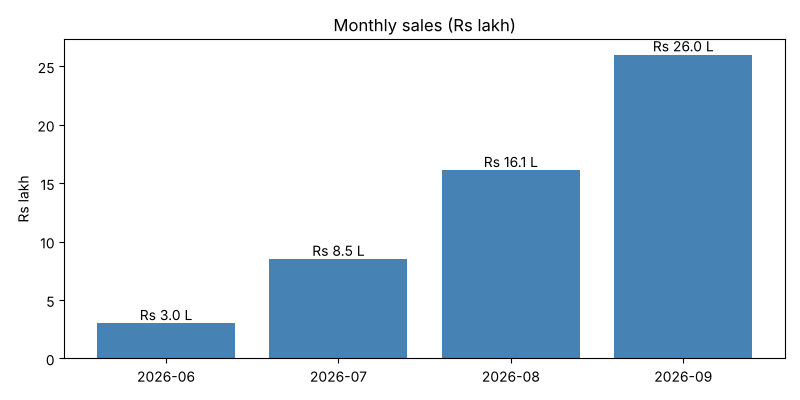
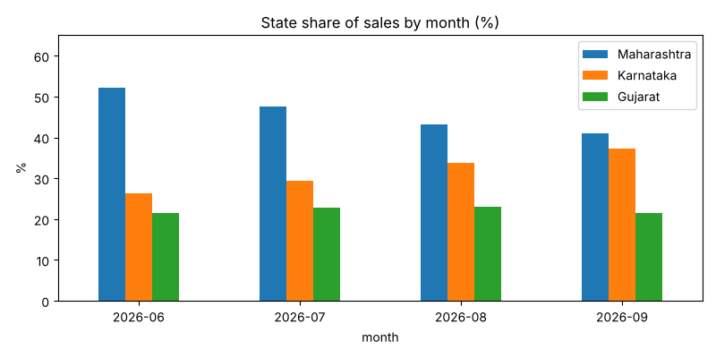
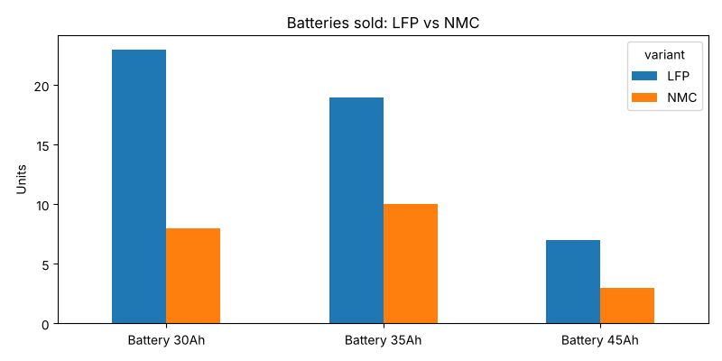
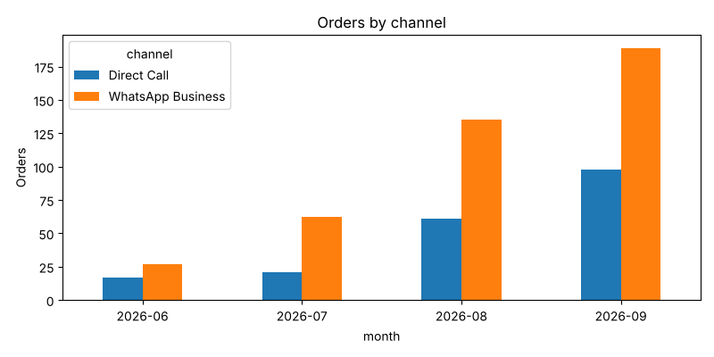
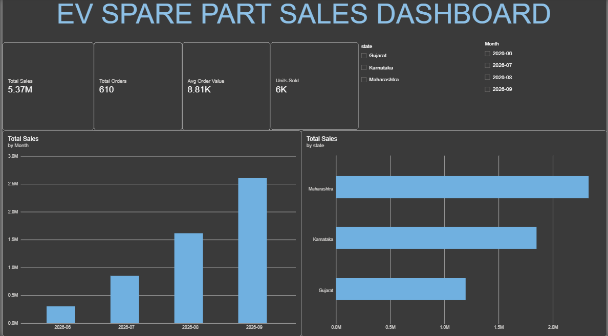
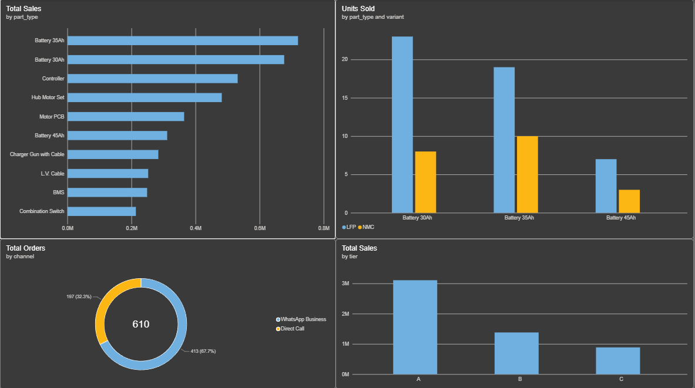

# EV Spare Parts Sales Analysis

**Tools:** SQL · Python (pandas, matplotlib) · Power BI

Sales analysis of an EV two-wheeler spare parts business that started in **June 2026** and grew monthly sales from **₹3 lakh to ₹26 lakh in 3 months**.

> The data in this project is **sample data**. It follows how the business works, but the shop names and individual orders are made up.

## The business
- Customers are **EV repair shops** in Maharashtra, Gujarat and Karnataka, grouped by size: A (large), B (medium), C (small).
- Orders come on **WhatsApp Business** or by **direct call**, and parts are shipped to the shop.
- Parts: batteries 30Ah / 35Ah / 45Ah (LFP and NMC), BMS, controllers, hub motor sets (48V / 60V / 72V), DC-DC converters, motor PCB, MOSFETs, motor hall sensors, motor magnets, combination switches, L.V. cables, charger guns with cable, brake sensors, master cylinders and unpainted fiber body parts (front panel, side panel, bottom panel, rear panel, floor board, inner cover, top cover, bottom cover, fender, number plate bracket).

## Questions
1. How did sales grow month by month?
2. Which states and cities sell the most?
3. Which parts sell the most? LFP or NMC batteries?
4. How many orders come on WhatsApp vs direct call?
5. Which shop size brings the most sales, and which shops stopped ordering?

## Findings
| | Jun | Jul | Aug | Sep |
|---|---|---|---|---|
| Sales | ₹3.0 L | ₹8.5 L | ₹16.1 L | ₹26.0 L |
| Maharashtra share | 52% | 48% | 43% | 41% |
| Karnataka share | 26% | 29% | 34% | 37% |

- Sales grew every month. Karnataka's share rose every month.
- Batteries are the biggest category, and LFP batteries sell more than NMC.
- About two-thirds of orders come on WhatsApp Business.
- 30 large (A) shops give 58% of sales, so they are the key accounts.
- 26 shops have not ordered since August, so they go on the follow-up call list.






## Power BI dashboard
Two pages built in Power BI Desktop from the 5 CSV files.

**Sales Overview:** 4 KPI cards (Total Sales, Total Orders, Avg Order Value, Units Sold), monthly sales, sales by state, and State / Month filters.



**Parts & Shops:** top 10 parts by sales, batteries LFP vs NMC, orders by channel (WhatsApp vs Direct Call), and sales by shop size.



Measures (DAX):
```
Total Sales     = SUM(order_items[net_amount])
Total Orders    = DISTINCTCOUNT(orders[order_id])
Avg Order Value = DIVIDE([Total Sales], [Total Orders])
Units Sold      = SUM(order_items[quantity])
```

## Files
```
data/        orders, order_items, customers, cities, parts (CSV)
sql/         sales_analysis.sql – 9 queries (JOIN, GROUP BY, SUM, HAVING)
notebooks/   ev_spare_parts_sales.ipynb – analysis and charts in pandas
powerbi/     EV_Spare_Parts_Dashboard.pbix – Power BI dashboard
images/      charts and dashboard screenshots
```

## Author
**Rehan Deshmukh** · Sales Manager, EV spare parts · Pune
